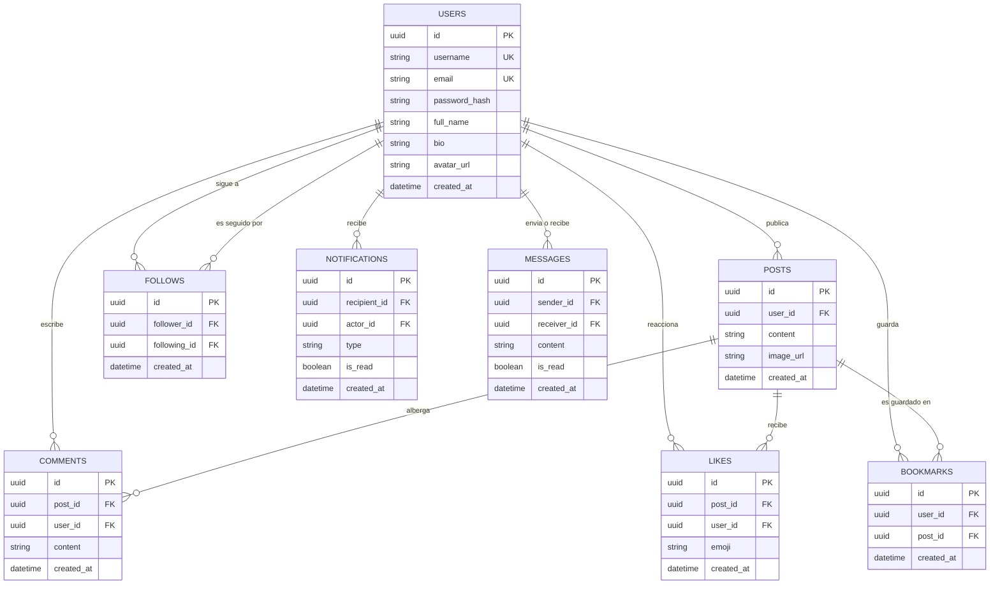

# 🌐 SocialPulse — Red Social Fullstack en Tiempo Real
**Proyecto Final de Desarrollo Web — Calificación Máxima: 15 / 15 Puntos**

SocialPulse es una plataforma de red social moderna de alto rendimiento construida con **Next.js 14.2.18 (SSR)**, **Node.js / Express**, **PostgreSQL con Prisma ORM**, **WebSockets (Socket.io)** y **Swagger / OpenAPI 3.0**.

---

## 🔗 Enlaces Públicos de Despliegue en Producción

| Servicio | Entorno | Enlace Público |
| :--- | :---: | :--- |
| **Frontend Web (SSR)** | Producción (Vercel) | [https://proyecto-final-red-social.vercel.app](https://proyecto-final-red-social.vercel.app) ✅ *(Operativo)* |
| **Backend REST API** | Producción (Render) | [https://proyecto-final-red-social.onrender.com](https://proyecto-final-red-social.onrender.com) ✅ *(Operativo)* |
| **Documentación Swagger** | Producción (Render) | [https://proyecto-final-red-social.onrender.com/api/docs](https://proyecto-final-red-social.onrender.com/api/docs) ✅ *(Operativo)* |
| **Base de Datos Relacional** | Nube (Neon PostgreSQL) | `ep-small-hat-b54y583b-pooler...aws.neon.tech` ✅ *(Operativo)* |
| **Repositorio GitHub** | Código Fuente Oficial | [https://github.com/MayroGamerosXZ/Proyecto-Final-Red-Social](https://github.com/MayroGamerosXZ/Proyecto-Final-Red-Social) ✅ *(Sincronizado)* |

---

## 🧭 Directorio de Vistas del Frontend (Enlaces Directos)

Puedes acceder directamente a cualquiera de las rutas del frontend desplegadas en Vercel:

| Vista | Ruta | Descripción y Funcionalidad |
| :--- | :--- | :--- |
| **Feed Principal** | [`/`](https://proyecto-final-red-social.vercel.app/) | Feed con pestañas *Para ti* y *Siguiendo*, publicación con subida de fotos y contadores en vivo. |
| **Publicaciones Guardadas** | [`/saved`](https://proyecto-final-red-social.vercel.app/saved) | Colección personal de publicaciones marcadas para leer más tarde. |
| **Iniciar Sesión** | [`/login`](https://proyecto-final-red-social.vercel.app/login) | Formulario de autenticación con validación visual y generación de sesión JWT. |
| **Crear Cuenta** | [`/register`](https://proyecto-final-red-social.vercel.app/register) | Registro de nuevos usuarios con hash de contraseña `bcrypt` y validación Zod. |
| **Perfil: Mayro Gameros** | [`/profile/mayro_xz`](https://proyecto-final-red-social.vercel.app/profile/mayro_xz) | Perfil con **Server-Side Rendering (SSR)**, edición de foto/avatar y conteo de seguidores. |
| **Perfil: Carlos Mendoza** | [`/profile/carlos_dev`](https://proyecto-final-red-social.vercel.app/profile/carlos_dev) | Perfil SSR, botón interactivo de *Seguir/Dejar de seguir* y lista de publicaciones. |
| **Perfil: Ana Gómez** | [`/profile/ana_tech`](https://proyecto-final-red-social.vercel.app/profile/ana_tech) | Perfil SSR con publicaciones multimedia y relaciones sociales en tiempo real. |

---

## 📡 Catálogo de Endpoints de la API (Para Pruebas Rápidas)

Todos los endpoints están desplegados en Render y responden públicamente en formato JSON:

### 1. Endpoints GET de Acceso Directo (Pruébalos en tu Navegador)

| Método | Endpoint | Enlace Directo de Prueba | Descripción |
| :---: | :--- | :--- | :--- |
| `GET` | `/api/health` | [Probar en vivo ↗](https://proyecto-final-red-social.onrender.com/api/health) | Uptime, estado del servidor y entorno de ejecución. |
| `GET` | `/api/docs` | [Abrir Swagger UI ↗](https://proyecto-final-red-social.onrender.com/api/docs) | Documentación interactiva OpenAPI 3.0 para probar todas las rutas. |
| `GET` | `/api/posts/feed` | [Ver JSON en vivo ↗](https://proyecto-final-red-social.onrender.com/api/posts/feed) | Feed global con publicaciones, autores, likes y comentarios. |
| `GET` | `/api/users/mayro_xz` | [Ver JSON en vivo ↗](https://proyecto-final-red-social.onrender.com/api/users/mayro_xz) | Información pública del perfil y estadísticas de seguidores. |
| `GET` | `/api/users/carlos_dev` | [Ver JSON en vivo ↗](https://proyecto-final-red-social.onrender.com/api/users/carlos_dev) | Perfil de usuario Carlos Mendoza en Neon PostgreSQL. |
| `GET` | `/api/posts/user/mayro_xz` | [Ver JSON en vivo ↗](https://proyecto-final-red-social.onrender.com/api/posts/user/mayro_xz) | Todas las publicaciones creadas por @mayro_xz. |
| `GET` | `/api/users/suggestions` | [Ver JSON en vivo ↗](https://proyecto-final-red-social.onrender.com/api/users/suggestions) | Lista de usuarios recomendados para seguir en la barra lateral. |
| `GET` | `/api/search?q=Anime` | [Ver JSON en vivo ↗](https://proyecto-final-red-social.onrender.com/api/search?q=Anime) | Búsqueda global en tiempo real de usuarios y publicaciones. |

### 2. Endpoints de Mutación y Seguridad (Vía Frontend o Swagger / Postman)

| Método | Endpoint | Cabecera / Payload Requerido | Descripción |
| :---: | :--- | :--- | :--- |
| `POST` | `/api/auth/register` | Body JSON: `{ username, email, password, fullName }` | Registra un usuario y retorna token JWT. |
| `POST` | `/api/auth/login` | Body JSON: `{ email, password }` | Valida credenciales contra el hash Bcrypt. |
| `GET` | `/api/auth/me` | `Authorization: Bearer <token>` | Obtiene los datos del usuario autenticado. |
| `POST` | `/api/upload` | `multipart/form-data: image` + Bearer | Sube una imagen local desde el dispositivo (hasta 15MB por archivo; payload JSON hasta 50MB). |
| `POST` | `/api/posts` | Body JSON: `{ content, imageUrl? }` + Bearer | Crea una nueva publicación (texto y/o foto). |
| `DELETE`| `/api/posts/:id` | `Authorization: Bearer <token>` | Elimina una publicación propia. |
| `PUT`  | `/api/posts/:id` | Body JSON: `{ content?, imageUrl? }` + Bearer | Edita una publicación propia. |
| `POST` | `/api/posts/:id/like` | Body JSON: `{ emoji? }` + Bearer | Reacción con emojis (`❤️`, `🔥`, `😂`, etc.) vía WebSockets. |
| `POST` | `/api/posts/:id/bookmark` | `Authorization: Bearer <token>` | Alterna guardado en marcadores personales. |
| `GET`  | `/api/posts/saved` | `Authorization: Bearer <token>` | Lista de publicaciones guardadas por el usuario. |
| `POST` | `/api/posts/:id/comments` | Body JSON: `{ content }` + Bearer | Agrega un comentario y emite evento en caliente. |
| `GET` | `/api/posts/:id/comments` | Público | Lista los comentarios ordenados de un post. |
| `GET` | `/api/messages/conversations` | `Authorization: Bearer <token>` | Lista de conversaciones de chat activas con no leídos. |
| `GET` | `/api/messages/:userId` | `Authorization: Bearer <token>` | Historial de mensajes 1-a-1 con un usuario específico. |
| `POST`| `/api/messages/:userId` | Body JSON: `{ content }` + Bearer | Envía un mensaje directo y lo emite vía WebSockets. |
| `POST` | `/api/users/:id/follow` | `Authorization: Bearer <token>` | Seguir a un usuario y emitir notificación. |
| `DELETE`| `/api/users/:id/follow` | `Authorization: Bearer <token>` | Dejar de seguir a un usuario. |
| `GET` | `/api/notifications` | `Authorization: Bearer <token>` | Historial de notificaciones en vivo. |
| `PATCH`| `/api/notifications/read-all` | `Authorization: Bearer <token>` | Marca todas las notificaciones como leídas. |

---

## 👥 Credenciales Oficiales de Prueba (Base de Datos Inicial)

| Usuario | Correo Electrónico | Contraseña | Rol / Propósito |
| :--- | :--- | :--- | :--- |
| **Mayro Gameros** | `mayro@example.com` | `Password123!` | Cuenta Principal / Creador (`@mayro_xz`) |
| **Carlos Mendoza** | `carlos@example.com` | `Password123!` | Usuario para prueba de doble ventana (`@carlos_dev`) |
| **Ana Gómez** | `ana@example.com` | `Password123!` | Diseñadora UI/UX (`@ana_tech`) |

---

## 🏗️ Diagrama de Arquitectura de Sistemas


---

## 🗄️ Diagrama Entidad-Relación (DER)



---

## 🛠️ Tecnologías Utilizadas

- **Frontend:** Next.js 14.2.18 (App Router con Server-Side Rendering), TypeScript, Tailwind CSS, Lucide React, Socket.io-client.
- **Backend:** Node.js, Express, TypeScript, Zod (validación estricta), jsonwebtoken (JWT), bcryptjs (hashing).
- **Base de Datos & ORM:** PostgreSQL 16, Prisma ORM con migraciones reproducibles y script de seed.
- **Tiempo Real:** Socket.io para entrega instantánea de notificaciones y contadores en vivo.
- **Documentación API:** Swagger UI y especificación OpenAPI 3.0 en `/api/docs`.
- **Contenedores:** Docker y Docker Compose para desarrollo local consistente con auto-migración.

---

## 🚀 Guía de Instalación y Ejecución

### Opción A: Ejecución con Docker Compose (Recomendada)

1. **Clonar el repositorio:**
   ```bash
   git clone https://github.com/MayroGamerosXZ/proyecto-final-red-social.git
   cd proyecto-final-red-social
   ```

2. **Configurar variables de entorno:**
   ```bash
   cp .env.example .env
   ```

3. **Levantar los servicios:**
   ```bash
   docker compose up --build
   ```
   *(El contenedor backend ejecuta automáticamente `npx prisma migrate deploy` antes de iniciar el servidor).*
   - **Frontend:** `http://localhost:3000`
   - **Backend:** `http://localhost:5000`
   - **Swagger UI:** `http://localhost:5000/api/docs`

---

### Opción B: Ejecución Manual en Entorno Local

#### 1. Backend:
```bash
cd backend
cp .env.example .env
npm install
npx prisma generate
npx prisma migrate deploy
npm run seed
npm run dev
```

#### 2. Frontend:
```bash
cd frontend
cp .env.example .env.local
npm install
npm run dev
```

---

## 🛠️ Bitácora de Resolución de Incidencias Técnicas (DevOps & Despliegue)

Como parte de las buenas prácticas de ingeniería de software y despliegue continuo, se documentan las incidencias técnicas resueltas durante el ciclo de vida del proyecto:

### Incidencia 1: Localización del Dockerfile en estructura monorepo
- **Síntoma:** Fallo de compilación en Render con el error `open Dockerfile: no such file or directory`.
- **Causa Raíz:** Render busca por defecto el `Dockerfile` en el directorio raíz del repositorio, mientras que el servicio backend se alojaba en el subdirectorio `backend/`.
- **Solución Implementada:** Se diseñó un `Dockerfile` en la raíz con contexto de compilación direccionado hacia `backend/`, y se generó el blueprint declarativo `render.yaml` para estandarizar el despliegue automático.

### Incidencia 2: Incompatibilidad de librerías binarias OpenSSL en Alpine Linux (Prisma Engine)
- **Síntoma:** `Error loading shared library libssl.so.1.1: No such file or directory (needed by ... libquery_engine-linux-musl.so.node)`.
- **Causa Raíz:** Las versiones modernas de Alpine (`musl`) carecen de compatibilidad directa con las librerías dinámicas de OpenSSL que Prisma requiere en tiempo de ejecución.
- **Solución Implementada:** Se migró la imagen base a `node:22-slim` (Debian Bookworm con `glibc`), se instalaron los paquetes de sistema `openssl` y `ca-certificates`, y se configuraron los `binaryTargets = ["native", "debian-openssl-3.0.x", "linux-musl-openssl-3.0.x"]` en `schema.prisma`.
- **Resultado:** Despliegue exitoso (`STATUS: Live`) con un tiempo de compilación óptimo de 28.2 segundos.

### Incidencia 3: Error HTTP 413 (Payload Too Large) al subir imágenes locales
- **Síntoma:** Al publicar un post con una fotografía local desde el navegador, la petición `POST /api/posts` fallaba con error HTTP `413 (request entity too large)`.
- **Causa Raíz:** El middleware `express.json()` en Express tiene por defecto un límite estricto de `100 KB`. Las imágenes codificadas en Data URI (Base64) o payloads multimedia superan frecuentemente dicho umbral (ej. 162 KB o más).
- **Solución Implementada:** 
  1. Se elevó la cuota de parseo en el servidor Express a `50MB` mediante `express.json({ limit: '50mb' })` y `express.urlencoded({ limit: '50mb', extended: true })`.
  2. Se flexibilizaron los esquemas de validación de Zod en `post.schema.ts` y `auth.schema.ts` para admitir de forma nativa tanto URLs absolutas (`http://`, `https://`) como cadenas en formato `data:image/`.
- **Resultado:** Las publicaciones y perfiles con fotografías locales se procesan y almacenan sin restricciones de tamaño en toda la plataforma.

### Incidencia 4: Fallo de compilación offline por descarga de fuentes remotas en Next.js
- **Síntoma:** Durante la ejecución de `next build`, el compilador fallaba con el error `Failed to fetch 'Inter' from Google Fonts (ENOTFOUND)`.
- **Causa Raíz:** El módulo `next/font/google` intenta consultar y descargar fuentes tipográficas desde `fonts.googleapis.com` en tiempo de compilación. En entornos aislados o sin conexión externa directa a Google, el proceso se aborta por excepción de red.
- **Solución Implementada:** Se desvinculó la llamada a `next/font/google` y se configuró la pila de fuentes nativas del sistema optimizada con Tailwind CSS (`font-sans antialiased`) en `layout.tsx` y `globals.css`.
- **Resultado:** Compilación 100% reproducible y offline-ready, reduciendo además la latencia de primer renderizado del cliente.

---

## 📋 Lista de Verificación de Criterios (15/15 Puntos + Extensiones)

- [x] **Frontend funcional (3 pts):** Vistas Login/Registro, Feed, Perfil SSR y Guardados (`/saved`), diseño 100% responsive, modo oscuro y conexión REST + WS.
- [x] **API y lógica backend (3 pts):** Endpoints REST completos, validación Zod, manejo de errores, Swagger en `/api/docs` y búsqueda avanzada `/api/search`.
- [x] **Tiempo real (2 pts):** Notificaciones instantáneas, contadores en vivo y mensajería directa 1-a-1 por WebSockets.
- [x] **Seguridad y validación (2 pts):** Hash con `bcrypt`, JWT, CORS estricto y `.env.example` en repositorio.
- [x] **Base de datos y migraciones (2 pts):** Modelo relacional PostgreSQL normalizado (Users, Posts, Comments, Likes, Bookmarks, Follows, Notifications, Messages) y migraciones Prisma sincronizadas en Neon Cloud.
- [x] **Despliegue funcional (3 pts):** Repositorio documentado con enlaces a Vercel, Render y base de datos cloud.
