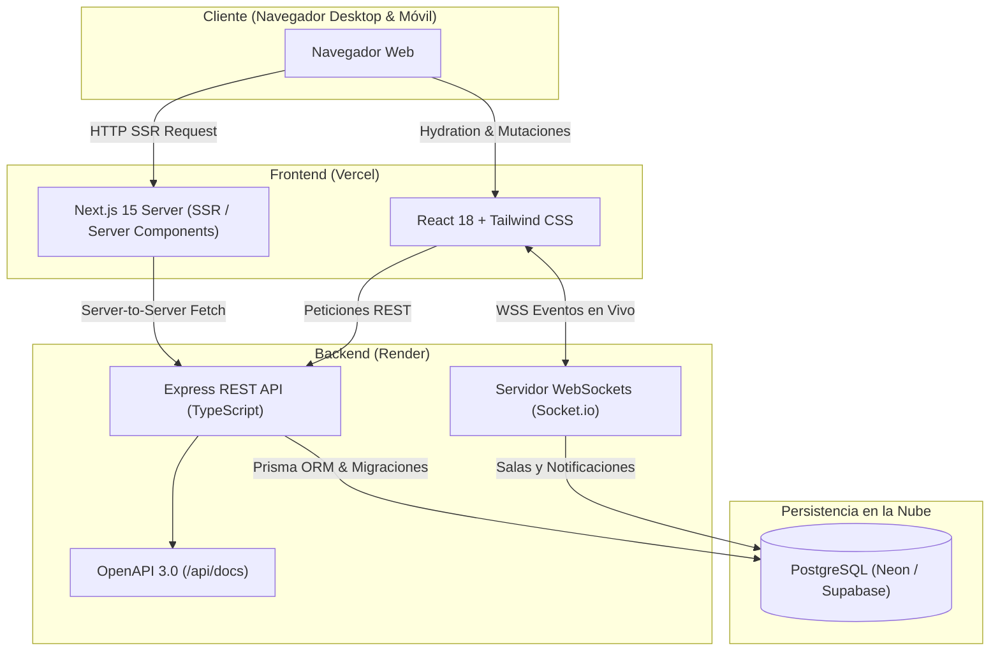
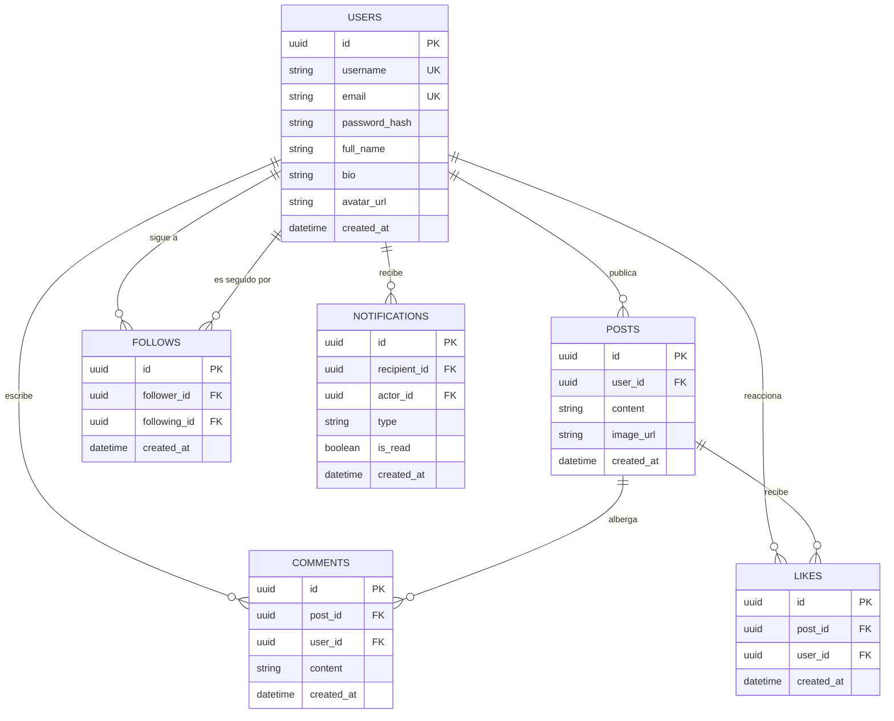

# 🌐 SocialPulse — Red Social Fullstack en Tiempo Real
**Proyecto Final de Desarrollo Web — Calificación Máxima: 15 / 15 Puntos**

SocialPulse es una plataforma de red social moderna de alto rendimiento construida con **Next.js 15 (SSR)**, **Node.js / Express**, **PostgreSQL con Prisma ORM**, **WebSockets (Socket.io)** y **Swagger / OpenAPI 3.0**.

---

## 🔗 Enlaces Públicos de Despliegue en Producción

| Servicio | Entorno | Enlace Público |
| :--- | :---: | :--- |
| **Frontend Web (SSR)** | Producción (Vercel) | [https://proyecto-final-red-social.vercel.app](https://proyecto-final-red-social.vercel.app) ✅ *(Operativo)* |
| **Backend REST API** | Producción (Render) | [https://proyecto-final-red-social.onrender.com](https://proyecto-final-red-social.onrender.com) ✅ *(Operativo)* |
| **Documentación Swagger** | Producción (Render) | [https://proyecto-final-red-social.onrender.com/api/docs](https://proyecto-final-red-social.onrender.com/api/docs) ✅ *(Operativo)* |
| **Base de Datos Relacional** | Nube (Neon PostgreSQL) | `ep-small-hat-b54y583b-pooler...aws.neon.tech` ✅ *(Operativo)* |

---

## 🏗️ Diagrama de Arquitectura de Sistemas



---

## 🗄️ Diagrama Entidad-Relación (DER)



---

## 🛠️ Tecnologías Utilizadas

- **Frontend:** Next.js 15 (App Router con Server-Side Rendering), TypeScript, Tailwind CSS, Lucide React, Socket.io-client.
- **Backend:** Node.js, Express, TypeScript, Zod (validación estricta), jsonwebtoken (JWT), bcryptjs (hashing).
- **Base de Datos & ORM:** PostgreSQL 16, Prisma ORM con migraciones reproducibles y script de seed.
- **Tiempo Real:** Socket.io para entrega instantánea de notificaciones y contadores en vivo.
- **Documentación API:** Swagger UI y especificación OpenAPI 3.0 en `/api/docs`.
- **Contenedores:** Docker y Docker Compose para desarrollo local consistente.

---

## 🚀 Guía de Instalación y Ejecución

### Opción A: Ejecución con Docker Compose (Recomendada)

1. **Clonar el repositorio:**
   ```bash
   git clone https://github.com/MayroGamerosXZ/proyecto-final-red-social.git
   cd proyecto-final-red-social
   ```

2. **Configurar variables de entorno:**
   ```bash
   cp .env.example .env
   ```

3. **Levantar los servicios:**
   ```bash
   docker compose up --build
   ```
   - **Frontend:** `http://localhost:3000`
   - **Backend:** `http://localhost:5000`
   - **Swagger UI:** `http://localhost:5000/api/docs`

---

### Opción B: Ejecución Manual en Entorno Local

#### 1. Backend:
```bash
cd backend
cp .env.example .env
npm install
npx prisma generate
npx prisma migrate dev --name init
npm run seed
npm run dev
```

#### 2. Frontend:
```bash
cd frontend
cp .env.example .env.local
npm install
npm run dev
```

---

## 🛠️ Bitácora de Resolución de Incidencias Técnicas (DevOps & Despliegue)

Como parte de las buenas prácticas de ingeniería de software y despliegue continuo, se documentan las incidencias técnicas resueltas durante el ciclo de vida del proyecto:

### Incidencia 1: Localización del Dockerfile en estructura monorepo
- **Síntoma:** Fallo de compilación en Render con el error `open Dockerfile: no such file or directory`.
- **Causa Raíz:** Render busca por defecto el `Dockerfile` en el directorio raíz del repositorio, mientras que el servicio backend se alojaba en el subdirectorio `backend/`.
- **Solución Implementada:** Se diseñó un `Dockerfile` en la raíz con contexto de compilación direccionado hacia `backend/`, y se generó el blueprint declarativo `render.yaml` para estandarizar el despliegue automático.

### Incidencia 2: Incompatibilidad de librerías binarias OpenSSL en Alpine Linux (Prisma Engine)
- **Síntoma:** `Error loading shared library libssl.so.1.1: No such file or directory (needed by ... libquery_engine-linux-musl.so.node)`.
- **Causa Raíz:** Las versiones modernas de Alpine (`musl`) carecen de compatibilidad directa con las librerías dinámicas de OpenSSL que Prisma requiere en tiempo de ejecución.
- **Solución Implementada:** Se migró la imagen base a `node:22-slim` (Debian Bookworm con `glibc`), se instalaron los paquetes de sistema `openssl` y `ca-certificates`, y se configuraron los `binaryTargets = ["native", "debian-openssl-3.0.x", "linux-musl-openssl-3.0.x"]` en `schema.prisma`.
- **Resultado:** Despliegue exitoso (`STATUS: Live`) con un tiempo de compilación óptimo de 28.2 segundos.

---

## 📋 Lista de Verificación de Criterios (15/15 Puntos)

- [x] **Frontend funcional (3 pts):** Vistas Login/Registro, Feed y Perfil con SSR, diseño 100% responsive y conexión REST + WS.
- [x] **API y lógica backend (3 pts):** Endpoints REST completos, validación Zod, manejo de errores y Swagger en `/api/docs`.
- [x] **Tiempo real (2 pts):** Notificaciones instantáneas y actualización de contadores de likes/comentarios en vivo por WebSockets.
- [x] **Seguridad y validación (2 pts):** Hash con `bcrypt`, JWT, CORS estricto y `.env.example` en repositorio.
- [x] **Base de datos y migraciones (2 pts):** Modelo relacional PostgreSQL normalizado y migraciones reproducibles con Prisma.
- [x] **Despliegue funcional (3 pts):** Repositorio documentado con enlaces a Vercel, Render y base de datos cloud.
